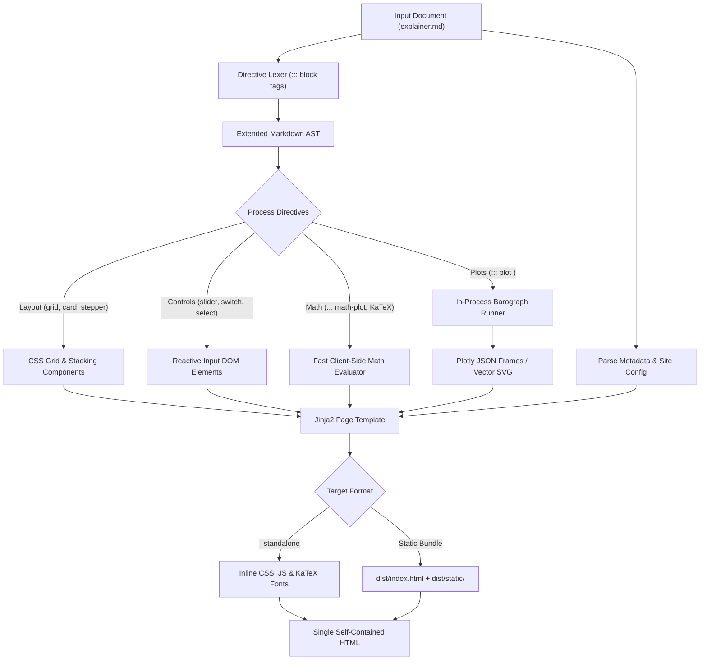
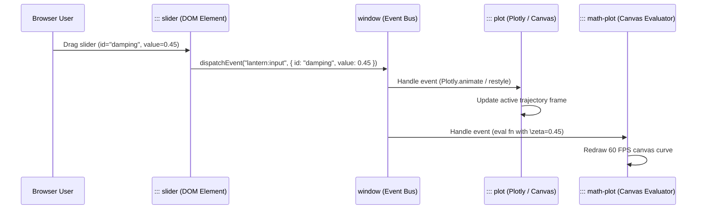

# Architecture & Pipeline

Lantern transforms Markdown enriched with custom directives into high-performance web artifacts, coordinating in-process Python computation and reactive browser runtimes.

---

## Compilation Architecture

Lantern parses Markdown documents through a custom directive tokenizer, embeds interactive JavaScript widgets, executes referenced Python simulation scripts via Barograph, and compiles the final DOM tree:



---

## Directive Parsing AST

Standard Markdown does not accommodate reactive widgets, multi-column bento grids, or stepper cards. Lantern extends Python-Markdown with custom block processors matching the `::: <directive> [params]` delimiter:

```markdown
::: slider id="damping" label="Damping Ratio (\zeta)" min=0.0 max=2.0 step=0.05 default=0.7 unit=""
:::

::: plot simulate_oscillator.py backend=plotly height=450px title="Transient Response"
:::
```

During lexing:
1. Block parameters are validated against directive schemas.
2. Container directives (`::: grid`, `::: card`, `::: stepper`) parse sub-delimiters (e.g. `=== Step 1: Title`).
3. Markdown content nested inside containers is parsed recursively, enabling math, code blocks, and callouts inside cards or tabs.

---

## Reactive Event Model

Lantern adopts a decentralized, zero-framework reactive event model based on native DOM Custom Events:



- Any slider, switch, or button emits a `lantern:input` CustomEvent containing its identifier and current value.
- Visualizers (Plotly frames, Canvas walkers, math evaluators) subscribe to `lantern:input` and update their state without full page reloads or virtual DOM diffing.

---

## Barograph and Plotly Pipeline

When encountering a `::: plot <script.py>` directive:
1. Lantern invokes `barograph.runner.run_script` in-process.
2. The standalone script is executed in an isolated Python namespace.
3. If the returned figure is a Plotly `go.Figure`, Lantern serializes its data, layout, and configuration into JSON and embeds it via the Plotly JavaScript runtime.
4. If the script defines animation frames matching slider IDs, slider dragging automatically scrubs the Plotly frame timeline.

---

## Standalone Bundler

When compiling with `--standalone`, Lantern packs all assets into a single distributable HTML file:
- CSS stylesheets (modern dark palette with slate `#0F172A` background and amber `#F59E0B` accents) are inlined into `<style>` blocks.
- KaTeX fonts (WOFF2) and runtime scripts are base64-encoded or inlined.
- Standalone HTML files can be opened offline, stored on network shares, or uploaded as self-contained artifacts.
